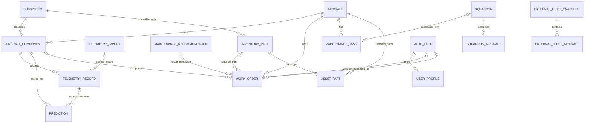

# AeroPulse Integrated Database Audit

**Snapshot date:** 2026-10-15
**Scope:** read-only inspection of the integrated backend's model source, migrations, database settings, and the local SQLite file. No migration, seed, application database write, or remote database connection was performed.

## Executive summary

The Django source and migration history define fleet, telemetry, prediction, work-order, inventory, maintenance, squadron, and user-profile tables. The only database file found in the integrated project was `backend/db.sqlite3`; it existed at **0 bytes**. An empty zero-byte file is not an initialized SQLite database and contains no readable tables. Consequently this report can describe the declared schema, but cannot truthfully report live row counts, provenance of persisted rows, null rates, or orphan counts. No hosted database was accessed; settings may select PostgreSQL when `DATABASE_URL` is configured, and that source was not queried.

The schema does not represent facility-specific inventory, flight time from an aircraft/fleet to a base, or base occupancy/reservations. Existing `fleet.Aircraft.total_flight_hours` and `squadron.SquadronAircraft.flight_hours` are accumulated usage fields, not route flight time. Current schema therefore cannot establish real scheduling feasibility.

## Database configuration and inspected contents

`backend/config/settings.py` defines the selection in `database_config()`:

| Selection | Engine/path | Audit treatment |
| --- | --- | --- |
| Django test or pytest process | SQLite `:memory:` | Isolated in-memory test setting. No test database was created for this audit. |
| `DATABASE_URL` absent | SQLite at `backend/db.sqlite3` | The configured local default. File exists, size 0 bytes, SHA-256 `e3b0c44298fc1c149afbf4c8996fb92427ae41e4649b934ca495991b7852b855`; no tables or rows can be read. |
| `DATABASE_URL` set to `postgres://` or `postgresql://` | PostgreSQL parsed from environment | Configuration path only. No URL value is reproduced and no connection was attempted. |

The project also has `backend/.env.example`; this is a template and is not evidence of database contents. The applicable local settings file or environment may vary by contributor. The audit discovered no other `.sqlite3`, `.sqlite`, or `.db` file under the integrated project outside ignored virtual environments and caches.

The source migration files present are `fleet/migrations/0001_initial.py` through `0009_prediction_inference_details.py`, `maintenance/migrations/0001_initial.py` through `0003_assetpart.py`, and `squadron/migrations/0001_initial.py` through `0004_squadronaircraft.py`. Their presence records intended schema evolution; because the local SQLite file is empty, no applied migration state was available to compare with them.

**Observed database contents:** none available. For every model below, row count, populated values, record provenance, null distribution, and orphan counts are **not measurable from the inspected local database**. Do not read this schema inventory as a claim that rows exist.

## Schema and models

Names below use Django's default `{app_label}_{model_name}` table naming; the inspected models do not override `db_table`. Primary keys are implicit `BigAutoField` IDs unless stated otherwise. Field summaries preserve declared types and nullability; `blank=True` affects validation and does not by itself mean SQL `NULL`.

Django creates indexes for ordinary `ForeignKey` fields by default. The constraint/index entries below call out additional declared uniqueness constraints, explicit compound indexes, and ordering metadata visible in model `Meta` classes; they do not represent an observed database's physical query plan.

### `fleet` application — `backend/fleet/models.py`

| Model / table | Fields (type; `?` means nullable) | Relationships and constraints | Purpose |
| --- | --- | --- | --- |
| `Aircraft` / `fleet_aircraft` | `aircraft_id` Char(32), unique; `aircraft_type` Char(80); `age_years` PositiveSmallInt; `total_flight_hours` Float default 0; `total_cycles` PositiveInt default 0; `base` Char(80); `health_score` Float? | Stable unique application identifier. `base` is text, not a facility FK. | Aircraft master record. |
| `UserProfile` / `fleet_userprofile` | `user` OneToOne FK to configured `AUTH_USER_MODEL`; `role` Char(32), choices admin/fleet_manager/maintenance_engineer/store_officer, default maintenance engineer; `created_at` DateTime auto | One-to-one user relation, cascade delete. | Optional application role profile. It does not itself enforce authorization. |
| `Subsystem` / `fleet_subsystem` | `code` Slug(64), unique; `name` Char(100); `service_interval_days` PositiveInt default 180; `service_interval_cycles` PositiveInt? | Unique code. | Component category and nominal service intervals. |
| `AircraftComponent` / `fleet_aircraftcomponent` | `aircraft` FK; `subsystem` FK; `serial_number` Char(80), blank allowed; `installed_at` Date?; `last_serviced_at` Date?; `flight_hours_since_service` Float default 0; `cycles_since_service` PositiveInt default 0 | Aircraft FK cascades; subsystem FK protects. Unique constraint `(aircraft, subsystem)`. | Component instance tied to aircraft and subsystem. |
| `InventoryPart` / `fleet_inventorypart` | `part_id` Char(40), unique; `name` Char(120); `compatible_subsystem` FK; `stock_on_hand`, `reserved_stock`, `reorder_point`, `lead_days` PositiveInt (defaults 0); `updated_at` DateTime auto | Subsystem FK protects. No facility/location FK. `available_stock` property is `max(stock_on_hand-reserved_stock, 0)`. | Aggregate catalogue/stock values, not base-specific stock proof. |
| `TelemetryImport` / `fleet_telemetryimport` | `file` File; `uploaded_by` user FK?; `created_at` DateTime auto; `status` Char(16) choices pending/processing/complete/failed; `error_message` Text blank; `synthetic_import_key` Char(64)? unique; `synthetic_manifest` JSON?; `synthetic_mission_impact` Float?; `upload_idempotency_key` Char(64)? unique | User FK set-null; unique nullable synthetic and upload keys. | Upload/import provenance and explicit synthetic-demo context. |
| `TelemetryRecord` / `fleet_telemetryrecord` | `component` FK; `source_import` FK?; `observed_at` DateTime; four sensor Float? fields (`vibration_mm_s`, `temperature_c`, `pressure_psi`, `oil_level_pct`); `flight_hours` Float?; `cycles` PositiveInt?; `telemetry_missing` Bool? | Component FK cascades; import FK set-null. Unique `(component, observed_at)`; index `(component, -observed_at)`. | Time-stamped component sensor observation and optional import trace. |
| `FaultEvent` / `fleet_faultevent` | `event_id` Char(40), unique; `component` FK; `fault_code` Char(80); `severity` Char(12) choices low/medium/high/critical; `occurred_at` DateTime; `resolved_at` DateTime?; `notes` Text blank | Component FK cascades; index `(component, -occurred_at)`. | Component fault history. |
| `MaintenanceRecommendation` / `fleet_maintenancerecommendation` | `component` FK; `required_part` FK?; `action` Char(240); `reason` Text; `due_by` DateTime?; `priority_score` Float; `status` Char(12) choices open/accepted/dismissed, default open; `created_at` DateTime auto | Component cascades; part set-null. | Advisory maintenance item; not a reservation. |
| `Prediction` / `fleet_prediction` | `component` FK; `source_telemetry` FK?; `inference_key` Char(64)? unique; `inference_details` JSON?; `model_version` Char(64); `scored_at` DateTime auto; six Float scores (`anomaly_score`, `failure_risk_score`, `maintenance_due_score`, `parts_risk_score`, `health_score`, `priority_score`); `explanation_factors` JSON list default | Component cascades; telemetry set-null; indexes `(component, -scored_at)`. Historical details and source telemetry can be null. | Persisted ML score and optional detail/source trace. |
| `ExternalFleetSnapshot` / `fleet_externalfleetsnapshot` | `source_url` URL; `source_name` Char(100), default GlobalMilitary.net; `source_updated_on` Date?; `retrieved_at` DateTime auto; `active_aircraft_total`, `aircraft_on_order_total` PositiveInt? | Ordered newest retrieved first. | Dated third-party fleet inventory snapshot metadata. |
| `ExternalFleetAircraft` / `fleet_externalfleetaircraft` | `snapshot` FK; `category` Char(40); `name` Char(120); `origin` Char(160) blank; `model_year` PositiveSmallInt?; `active` PositiveInt?; `yoy_change` Integer?; `ordered` PositiveInt? | Snapshot FK cascades; unique `(snapshot, name)`; ordered category/name. | Aircraft type/category counts in one external snapshot, not aircraft-level availability. |
| `WorkOrder` / `fleet_workorder` | `aircraft` FK; `aircraft_component` FK?; `recommendation` FK?; `required_part` FK?; `component` Char(100); `action` Char(240); `priority_score` Float default 0; `status` Char(16) choices pending/approved/assigned/resolved/cancelled, default pending; `created_by` user FK?; `approved_by` user FK?; `created_at` DateTime auto; `approved_at`, `completed_at` DateTime?; `downtime_hours` Float?; `outcome` Text blank | Aircraft cascades; component protects; recommendation and part set-null; user FKs set-null. No fleet, base, part quantity, scheduled interval, or reservation FK. | Human-reviewed work item with retrospective downtime field. |

### `maintenance` application — `backend/maintenance/models.py`

| Model / table | Fields | Relationships and constraints | Purpose |
| --- | --- | --- | --- |
| `MaintenanceTask` / `maintenance_maintenancetask` | `aircraft` FK; `squadron` FK nullable; `component` Char(100); `action` Char(240); `priority_score` Float default 0; `status` Char(16), pending/in_progress/completed/cancelled; `scheduled_for` DateTime?; `created_at` DateTime auto | Aircraft cascades; squadron protects. Ordered by descending priority then created time. No FK to `fleet.WorkOrder`. | Separate existing maintenance task API/model. |
| `AssetPart` / `maintenance_assetpart` | `aircraft` FK; `inventory_part` FK; `serial_number` Char(80), unique; `installed_location` Char(100) blank; `installed_on`, `last_maintained_on`, `next_maintenance_on` Date?; `status` Char(24), installed/in_service/under_maintenance/retired; `notes` Text blank; created/updated DateTime auto | Aircraft and inventory part protect; unique serial; index `(aircraft, status, next_maintenance_on)`. | Serialized part installed on an aircraft. `installed_location` is not a stock-room location or facility inventory relation. |

### `squadron` application — `backend/squadron/models.py`

| Model / table | Fields | Relationships and constraints | Purpose |
| --- | --- | --- | --- |
| `Squadron` / `squadron_squadron` | `squadron_id` Char(32), unique; `name` Char(120); `base` Char(80) blank; `aircraft_count` PositiveSmallInt?; `aircraft_type` Char(80) blank; `operational_role` Char(80) blank; `source_url` URL blank; `source_last_synced_at` DateTime? | No relationship to `fleet.Aircraft`. | External/reference squadron record. |
| `SquadronAircraft` / `squadron_squadronaircraft` | `squadron` FK; `aircraft_number` Char(40), unique; `aircraft_name` Char(120); `country_of_origin` Char(80); `year_inducted` PositiveSmallInt; `flight_hours` Decimal(10,1) default 0; `last_maintenance_on`, `next_maintenance_on` Date?; `operational_role` Char(100); created/updated DateTime auto | Squadron FK cascades; index `(squadron, next_maintenance_on)`. No FK to `fleet.Aircraft`. | Individually described aircraft assigned to the external squadron reference. Its flight hours are cumulative, not to-base travel time. |

Django's standard auth/contenttypes/session tables are also installed through `backend/config/settings.py`. The application links its profile and work-order user fields to `settings.AUTH_USER_MODEL`; this report does not enumerate framework-managed columns because no database schema was readable.

## Entity relationships

The diagram follows explicit foreign keys in `fleet/models.py`, `maintenance/models.py`, and `squadron/models.py`; optional relationships use `o|`. It deliberately does not draw a `SquadronAircraft` ↔ `fleet.Aircraft` edge: none exists. Likewise, `Aircraft.base` and `Squadron.base` are strings, and inventory has no facility relation. No base occupancy/reservation model was found.

## Contents, provenance, and integrity limits

- Local `backend/db.sqlite3`: zero bytes, uninitialized; no table counts are available. No configured PostgreSQL database was queried.
- Scraped snapshot records, API-created records, telemetry imports, predictions, and work orders therefore have no verifiable local row counts or provenance in this audit.
- `backend/data/fabricated/` contains CSV fixtures, not database rows and not scraped content. The generator identifies them as deterministic fabricated demo data; see `backend/scripts/generate_fabricated_data.py`.
- Schema safeguards include unique aircraft/subsystem component pairs, unique component/timestamp telemetry, unique inference keys when populated, unique external snapshot/name pairs, unique part IDs and work-order relationships. The schema does not by itself guarantee semantic identity matches across separate `fleet.Aircraft` and `squadron.SquadronAircraft` tables.
- No orphan scan was possible because no readable database existed. Existing FK constraints would constrain stored links once a schema is initialized; they cannot supply absent facility, fleet, or itinerary relationships.

## Scheduling readiness from persisted schema

| Required input | Classification | Evidence and limitation |
| --- | --- | --- |
| Aircraft identity | Supported by schema; persisted records unknown | `fleet.Aircraft.aircraft_id` is unique. |
| Fleet identity for one-fleet-per-base occupancy | Missing | No Fleet model or work-order fleet FK. Squadron is a separate reference entity and not linked to `fleet.Aircraft`. |
| Required parts per work order | Partially supported | `WorkOrder.required_part` allows one nullable part FK, with no quantity or multi-part relation. A recommendation also has one optional part. |
| Parts stock at candidate base | Missing | `InventoryPart` stock/reservations are global fields; no base/location FK or stock movement/reservation model. |
| Flight hours to reach candidate base | Missing | Aircraft/squadron flight-hour fields represent cumulative usage; no route/time-to-base field. |
| Current base occupancy | Missing | No base/reservation/occupancy model, scheduled interval, or base FK on work order. `MaintenanceTask.scheduled_for` is only one nullable timestamp and has no base relation. |
| Fixed 72 elapsed-hour maintenance interval | Supported by new isolated synthetic function only | `simple_scheduler.recommend_base_slots` calculates exactly 72 elapsed UTC hours. No persistent task duration or reservation exists. |

The isolated prototype's fixtures can test these rules but are explicitly artificial. They are not evidence about the contents or completeness of any operational system. No Django model, migration, API, or persistent database was changed for this scheduling prototype.

## Scheduling data gaps and safe interpretation

The current `fleet.WorkOrder` model cannot safely supply a fleet occupancy key, candidate base, multi-part quantities, or a verified base-specific part quantity. Its `downtime_hours` is retrospective and must not be repurposed. The public squadron reference data does not establish that an aircraft is operationally assigned to a given AeroPulse `Aircraft` record. The only defensible flight-hours-to-base value in the current prototype is an explicitly supplied synthetic fixture value. Until trusted operational sources and schema mappings exist, the recommender must remain non-operational and return insufficient data for real inputs.

## Addendum — isolated Indian aviation demo structure (2026-10-16)

The repository also contains the additive `demo_data` app and its migrations, plus a versioned synthetic fixture under `dev/indian_aviation_demo/`. This extends the declared integrated-project schema for demo identity references, synthetic fleets/aircraft assignment, base-specific synthetic stock, synthetic travel hours and occupancy, work-order part quantities, and synthetic maintenance history. It reuses existing `fleet.Aircraft`, `InventoryPart`, telemetry/import/prediction, and `WorkOrder` entities. These definitions and fixture entries do not prove corresponding rows exist in the configured persistent database.

At the initial read-only inspection, `backend/db.sqlite3` remained zero bytes. Two files named `backend/data/demo/aeropulse_demo.sqlite3` and `aeropulse_demo_complete.sqlite3` were also present (569,344 bytes each); their contents were not opened or modified, so no claims are made about their schema, row counts, or provenance. After that inspection, the safe initializer was run once against a previously absent path, `backend/data/demo/indian_aviation_demo.sqlite3`; it applied migrations and seeded only that new demo database. An ORM read reported three airbase references, five synthetic assets, three parts, nine base-stock rows, five maintenance-history examples, seven telemetry rows, five work orders, and zero predictions. The initializer then refused a second run against that same path. `backend/db.sqlite3` remained zero bytes; the other two database files remained unopened and unchanged. The fresh-database process is documented in [INDIAN_AVIATION_DEMO_DATA.md](INDIAN_AVIATION_DEMO_DATA.md).

The fixture includes source pointers for public names, but source pages were not fetched during this work. Base identity names therefore remain awaiting direct source verification. Aircraft type links to fictional demo assets are synthetic mappings. Part categories, stock quantities, telemetry, travel hours, occupancy, work orders, and maintenance dates/intervals are synthetic and non-operational. The seeded instance contains no ML predictions because artifact-backed inference was not requested.
