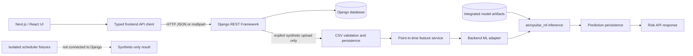

# Frontend Integration Guide

This guide is a source-verified handoff for a future Next.js/React client. The integrated repository currently contains no frontend application. Routes and serializers below describe the current backend implementation; they are not a promise that the API is production-ready. General setup and model/test limitations are in the [repository README](../README.md).

## 1. Integration objectives and boundaries

The frontend should render fleet, aircraft, telemetry, risk, work-order, inventory, maintenance-task, squadron, and parts data returned by the API. Centralize HTTP handling, parse responses at the boundary, and show loading, empty, validation, authorization, and server-error states.

The backend remains responsible for persistence, relationship handling, CSV validation, ML feature construction, inference, scoring, and prediction storage. The browser must not load joblib model files, connect directly to the database, reproduce scoring formulas, infer missing fields, or fabricate successful API responses. Keep display formatting separate from stored score meanings.

The risk API and the synthetic scheduler are different systems: risk predictions are persisted by Django and retrieved over HTTP; the scheduling prototype is pure Python, fixture-only, and has no API route.

## 2. Request architecture



For a supported demonstration upload, the backend validates the complete candidate CSV and trusted backend references before database writes, builds features only from observations at or before the prediction time, calls the integrated package, and persists predictions. Ordinary uploads follow inspection/readiness behavior and must not be presented as scored telemetry. The scheduler is not reachable from the API.

## 3. Frontend repository assumptions

No Next.js or React application directory exists in this integrated project, and no separate frontend repository structure was established during this inspection. The layout below is a recommendation, not an existing structure or instruction to reorganize this project.

Both Next.js App Router and Pages Router can use the same typed API client. In App Router, server components may fetch server-side where appropriate and client components can handle interactive forms. In Pages Router, use page data functions or client effects according to the screen. Never expose server credentials through `NEXT_PUBLIC_` variables.

## 4. Verified API catalogue

The API prefix is `/api`. Direct paths below are declared without a trailing slash. `DefaultRouter` endpoints use trailing slashes. DRF's default permission is `AllowAny`; authentication is optional in the current configuration, which is a security limitation, not an approved deployment policy. No global pagination class is configured, so list responses are ordinary arrays unless a view explicitly returns another shape.

| Methods and route | Purpose and request | Response contract and notes |
| --- | --- | --- |
| `POST /api/auth/signup` | JSON: `username`, optional `email`, `password` (minimum length 8; serializer calls Django password validation). | `201`; body `{ "user": { "id", "username", "email", "role" } }`; sets HttpOnly access and refresh cookies. Signup is public in current code. |
| `POST /api/auth/login` | JSON: `username`, `password`. | `200`; same `user` body shape; sets cookies. Invalid credentials produce serializer errors. |
| `POST /api/auth/refresh` | No JSON body; uses refresh cookie. | `204`; refresh/access cookies are set from SimpleJWT output. Missing refresh cookie returns `401`; invalid token follows serializer error handling. |
| `POST /api/auth/logout` | No JSON body; uses refresh cookie. | `205`; blacklists the refresh token and clears cookies. Invalid/missing refresh is a client error. |
| `GET /api/fleet/overview` | No parameters. | `200` object: `aircraft_total`, `mission_ready`, `at_risk`, `average_health_score`, `pending_work_orders`. `average_health_score` may be null. |
| `GET /api/fleet/aircraft/{aircraft_id}` | Path uses the aircraft's string identifier. | `200` Aircraft model fields: `id`, `aircraft_id`, `aircraft_type`, `age_years`, `total_flight_hours`, `total_cycles`, `base`, `health_score`. |
| `GET /api/fleet/aircraft/{aircraft_id}/telemetry` | No query parameters. | `200` array by component: `{ component, readings: [...] }`; up to 100 newest readings/component with `observed_at`, `vibration_mm_s`, `temperature_c`, `pressure_psi`, `oil_level_pct`. |
| `GET /api/fleet/aircraft/{aircraft_id}/risk` | No query parameters. | `200` array of each component's latest persisted prediction. See [Risk response](#5-risk-response-and-ml-output). Components without predictions are omitted. |
| `POST /api/fleet/imports/telemetry` | `multipart/form-data`: required `.csv` `file`; optional `demonstration_only=true` and required `mission_impact` for explicit synthetic scoring. | `201` body fields: `id`, `file`, `status`, `created_at`, `error_message`. Invalid explicit demo uploads return `400`; identical completed retry returns the existing import representation; telemetry conflicts return `400`. Ordinary CSV uploads remain inspection-only. |
| `GET /api/fleet/maintenance/queue` | No parameters. | `200` array of fleet WorkOrders, ordered by priority then creation time. |
| `POST /api/fleet/work-orders` | JSON serializer fields: `aircraft`, `component`, `action`, `priority_score`, `required_part`. `aircraft` and `required_part` are model relations represented by DRF relation identifiers; `component` is a text field, not the component FK. `status`, `created_at`, and `id` are read-only. | `201`; response includes `id`, writable fields, `status`, and `created_at`. New status is pending. |
| `GET`, `PUT`, `PATCH /api/fleet/work-orders/{id}` | Retrieve/update; integer primary key in path, WorkOrder serializer applies. | `200`; `status` remains read-only. No separate work-order approval endpoint was found in the router. |
| `GET /api/fleet/inventory` | No parameters. | `200` array: `part_id`, `name`, `stock_on_hand`, `reserved_stock`, `available_stock`, `reorder_point`, `lead_days`, `updated_at`. Global inventory is not facility/time-specific availability. |
| `GET /api/fleet/inventory/forecast` | No parameters. | `200` inventory records where `stock_on_hand <= reorder_point`; this is a reorder filter, not an availability forecast. |
| `GET /api/fleet/recommendations` | No parameters. | `200` array of stored maintenance advice: `id`, `component`, `required_part`, `action`, `reason`, `due_by`, `priority_score`, `status`, `created_at`. This is not slot scheduling. |
| `GET /api/fleet/iaf/fleet` | No parameters. | `200` stored snapshot with `source`, aggregate counts and aircraft entries (`name`, `category`, `origin`, `model_year`, `active`, `yoy_change`, `ordered`). If no snapshot exists, view returns `404`. Third-party snapshot data is not live operational availability. |
| Router CRUD `/api/fleet/squadrons/` | `GET` list, `POST` create; detail `GET`, `PUT`, `PATCH`, `DELETE` at `/{squadron_id}/`. | Squadron serializer exposes model fields plus nested read-only `fleet_aircraft`. Fields include `squadron_id`, `name`, `base`, `aircraft_count`, `aircraft_type`, `operational_role`, `source_url`, `source_last_synced_at`. |
| Router CRUD `/api/fleet/squadron-aircraft/` | List/create; detail uses `/{aircraft_number}/`. List accepts optional `?squadron={squadron_id}`. | Fields: `id`, `squadron`, `aircraft_number`, `aircraft_name`, `country_of_origin`, `year_inducted`, `flight_hours`, `last_maintenance_on`, `next_maintenance_on`, `operational_role`, `created_at`, `updated_at`. |
| Router CRUD `/api/maintenance/tasks/` | List/create/retrieve/update/delete; detail uses model primary key. | Fields: `id`, `aircraft`, `squadron`, `component`, `action`, `priority_score`, `status`, `scheduled_for`, `created_at`. This `MaintenanceTask` API is separate from fleet `WorkOrder`. |
| Router CRUD `/api/maintenance/spare-parts/` | List/create; detail key is `part_id`. | Fields: `id`, `part_id`, `name`, `compatible_subsystem`, stock/reservation/reorder/lead fields, `available_stock`, `updated_at`. |
| Router CRUD `/api/maintenance/asset-parts/` | List/create; detail key is `serial_number`. List accepts optional `?aircraft={aircraft_id}`. | Fields include aircraft ID, spare-part ID and nested `spare_part_details`, serial number, installation/maintenance dates, status, notes, and timestamps. |

Router CRUD reflects `ModelViewSet`; exact validation depends on each model serializer. Generic DRF validation errors normally use field-keyed JSON details. The backend does not define one frontend-specific error envelope. Handle non-2xx responses without assuming a fixed body shape. For generic views, standard not-found behavior may apply; direct views using `.get()` should be tested before relying on uniform missing-record behavior.

### Authentication and authorization facts

`REST_FRAMEWORK` configures SessionAuthentication, cookie JWT authentication, and DRF token authentication. `CookieJWTAuthentication` accepts a Bearer header or the configured HttpOnly access cookie. The global permission class is `AllowAny`; most routes have no stricter override. Thus login/signup and user roles do not mean ordinary fleet or maintenance APIs require authentication or enforce role access. Roles are `admin`, `fleet_manager`, `maintenance_engineer`, and `store_officer`, but no role-to-endpoint policy is established here. The signup serializer calls Django password validation, but settings configure an empty `AUTH_PASSWORD_VALIDATORS` list, so no server-side password-strength policy is currently configured through that setting.

Development CORS defaults include `http://localhost:3000` and `http://localhost:5173`, and credentials are allowed. `CORS_ALLOWED_ORIGINS` and `CSRF_TRUSTED_ORIGINS` are configurable. `JWT_COOKIE_SAMESITE` is `Lax`; cookies are secure when `DEBUG` is false. SessionAuthentication applies CSRF validation to authenticated unsafe requests. There is no approved frontend login/CSRF policy; coordinate with the backend/security owner before implementing authenticated write flows.

## 5. Risk response and ML output

The response remains a JSON array. Every item preserves these original fields:

| Field | Type | Meaning |
| --- | --- | --- |
| `component` | string | Subsystem code. |
| `model_version` | string | Persisted model version. |
| `health_score` | number in `[0,100]` | Health score; higher is better under the ML scoring formula. |
| `priority_score` | number | Model priority score; do not reinterpret as probability. |
| `explanation_factors` | string array | Rule-based explanation factors, not SHAP contributions. |

The current endpoint adds these 15 fields:

| Field | Type/nullable | Meaning and frontend handling |
| --- | --- | --- |
| `prediction_timestamp` | ISO timestamp or null | Observation/inference timestamp; falls back to source telemetry time when stored detail is absent and a source row exists. |
| `failure_probability` | number in `[0,1]` or null | Calibrated model probability for corrective repair within 15 days; not a guarantee. Historical prediction details may be absent. |
| `failure_risk_score` | number in `[0,100]` | Risk-scale representation; ML contract defines it as `100 * failure_probability`. Do not label it a probability percentage. |
| `prediction_horizon_days` | integer or null | Fixed model horizon of 15 days, not a separately predicted duration. |
| `anomaly_score` | number in `[0,100]` | Anomaly score; not failure probability. |
| `anomaly_status` | string or null | `unusual` or `not_flagged`; unusual is not a confirmed failure. |
| `maintenance_due_score` | number in `[0,100]` | Model score; unavailable context can produce a configured neutral score, with data-quality warnings. |
| `parts_risk_score` | number in `[0,100]` | Model score from inference inputs; it does not establish stock availability. |
| `score_components` | object or null | `failure_risk`, `anomaly`, `maintenance_due`, `parts_risk`, `mission_impact`; numeric components use the 0–100 model scales. |
| `priority_category` | string or null | `low`, `moderate`, `high`, or `critical`. |
| `model_name`, `feature_contract_version` | string or null | Model identity and feature-contract metadata. |
| `approved_for_production` | boolean or null | Current metadata is false; historical rows without inference details can return null. |
| `data_quality` | object or null | `warnings`, `missing_model_features`, `unsupported_calculations` string arrays and `valid` boolean. Null means details are unavailable, not “no warnings.” |
| `maintenance_recommendation` | object or null | Advisory object with `component`, `action`, `rules` (`rule_id`, `reason`), `advisory_only`, and `urgency`. It is not approval or scheduling. |

The backend persists scalar scores in prediction columns and selected extra outputs in nullable `Prediction.inference_details`. Historical rows are not backfilled: scalar scores remain available, while unrecoverable additional details are null. The current backend adapter does not pass facility/location context or SHAP contributions, so the risk API exposes neither a facility recommendation nor SHAP values. Although the ML package has optional facility-ranking code when supplied with context, its heuristic ranking is not proof of time-specific availability.

Illustrative shape only; this is not a real prediction:

```json
[
  {
    "component": "engine",
    "model_version": "1.1.0",
    "health_score": 0.0,
    "priority_score": 0.0,
    "explanation_factors": [],
    "prediction_timestamp": null,
    "failure_probability": null,
    "failure_risk_score": 0.0,
    "prediction_horizon_days": null,
    "anomaly_score": 0.0,
    "anomaly_status": null,
    "maintenance_due_score": 0.0,
    "parts_risk_score": 0.0,
    "score_components": null,
    "priority_category": null,
    "model_name": null,
    "feature_contract_version": null,
    "approved_for_production": null,
    "data_quality": null,
    "maintenance_recommendation": null
  }
]
```

The nulls illustrate a historical row without `inference_details`; score values are placeholders. Parse additive fields as nullable/optional and do not infer missing values.

## 6. Recommended client structure (proposal)

One framework-neutral organization could be:

```text
src/
  lib/api/              # base URL, fetch wrapper, endpoint functions
  lib/types/            # verified DTOs and runtime parsing helpers
  features/fleet/       # overview and aircraft screens
  features/risk/        # risk cards and data-quality display
  features/telemetry/   # upload/inspection UI
  features/maintenance/ # work orders, tasks, inventory, asset parts
  components/           # shared loading, empty, error and form states
```

This is suggested frontend organization, not a backend structure or requirement. Keep endpoint functions centralized, avoid duplicated URL construction, and use response-specific types. Runtime checks at network boundaries are useful; no new state-management dependency is required by this guide.

## 7. API URL and environment

For a browser-side local client, a future frontend may define `NEXT_PUBLIC_API_BASE_URL=http://127.0.0.1:8000/api`. `NEXT_PUBLIC_` values are embedded in browser bundles; they must never contain passwords, tokens, signing keys, or other secrets. The backend local port is 8000. A server-only URL can use a non-public variable such as `AEROPULSE_API_BASE_URL` if the frontend server needs a distinct target; this is a proposed frontend variable, not a backend setting.

The API origin may be `http://127.0.0.1:8000` while the browser page origin is `http://localhost:3000`; configure a CORS origin matching the browser page exactly. Do not put secrets into public variables. For local SQLite, leave `DATABASE_URL` unset. The checked-in backend example includes a placeholder `DATABASE_URL`; if copying that template for local use, remove/comment the placeholder rather than letting Django attempt to connect to it. Configure a database URL only for an intentionally isolated local database.

## 8. Typed API client example

These TypeScript interfaces reflect the current risk serializer. They are illustrative frontend types and must be revisited if backend serializers change:

```ts
export interface DataQuality {
  warnings: string[];
  missing_model_features: string[];
  unsupported_calculations: string[];
  valid: boolean;
}

export interface MaintenanceRecommendation {
  component: string;
  action: string;
  rules: Array<{ rule_id: string; reason: string }>;
  advisory_only: true;
  urgency: string;
}

export interface RiskItem {
  component: string;
  model_version: string;
  health_score: number;
  priority_score: number;
  explanation_factors: string[];
  prediction_timestamp: string | null;
  failure_probability: number | null;
  failure_risk_score: number;
  prediction_horizon_days: number | null;
  anomaly_score: number;
  anomaly_status: "unusual" | "not_flagged" | null;
  maintenance_due_score: number;
  parts_risk_score: number;
  score_components: {
    failure_risk: number;
    anomaly: number;
    maintenance_due: number;
    parts_risk: number;
    mission_impact: number;
  } | null;
  priority_category: "low" | "moderate" | "high" | "critical" | null;
  model_name: string | null;
  feature_contract_version: string | null;
  approved_for_production: boolean | null;
  data_quality: DataQuality | null;
  maintenance_recommendation: MaintenanceRecommendation | null;
}
```

Example fetch wrapper with timeout, non-2xx handling, and invalid/empty JSON handling:

```ts
const API_BASE = process.env.NEXT_PUBLIC_API_BASE_URL;
if (!API_BASE) throw new Error("NEXT_PUBLIC_API_BASE_URL is not configured");

export async function getRisk(aircraftId: string): Promise<RiskItem[]> {
  const controller = new AbortController();
  const timeout = setTimeout(() => controller.abort(), 10_000);
  try {
    const response = await fetch(
      `${API_BASE}/fleet/aircraft/${encodeURIComponent(aircraftId)}/risk`,
      { signal: controller.signal, headers: { Accept: "application/json" } },
    );
    const text = await response.text();
    if (!response.ok) {
      throw new Error(`Risk request failed (${response.status}): ${text || response.statusText}`);
    }
    if (!text) return [];
    let value: unknown;
    try { value = JSON.parse(text); }
    catch { throw new Error("Risk endpoint returned invalid JSON"); }
    if (!Array.isArray(value)) throw new Error("Risk endpoint returned an unexpected shape");
    return value as RiskItem[];
  } finally {
    clearTimeout(timeout);
  }
}
```

For stronger typing, validate array items rather than relying on a TypeScript cast. Surface aborts/timeouts as network errors; do not replace them with mock success data. Add `credentials: "include"` only if an approved cookie-auth flow requires it.

## 9. Incremental page plan

| Screen/step | Verified API | Data and UI states |
| --- | --- | --- |
| App shell and API configuration | No endpoint. | Validate base URL; show network/configuration errors. Confirm origin/CORS first. |
| Fleet overview | `GET /api/fleet/overview` | Loading, unavailable, and empty-fleet states; use returned aggregates. |
| Aircraft list/detail | No aircraft list endpoint found; known-ID detail uses `GET /api/fleet/aircraft/{aircraft_id}`. | A searchable list requires backend work. Do not synthesize it from squadron or external snapshot data without approval. |
| Telemetry detail | `GET /api/fleet/aircraft/{aircraft_id}/telemetry` | Display readings/timestamps with units; handle empty readings. |
| Risk analysis | `GET /api/fleet/aircraft/{aircraft_id}/risk` | Preserve score meanings; display null detail as unavailable, warnings distinctly, and production approval as false. |
| CSV inspection/upload | `POST /api/fleet/imports/telemetry` | Distinguish inspection from explicit synthetic import; surface field validation and import state. Never auto-import arbitrary data. |
| Work-order queue/detail | `GET /api/fleet/maintenance/queue`, `POST /api/fleet/work-orders`, `GET/PUT/PATCH /api/fleet/work-orders/{id}` | Status is read-only in this serializer; no dedicated approval/transition endpoint was found. |
| Maintenance tasks and parts | Router CRUD under `/api/maintenance/tasks/`, `/asset-parts/`, `/spare-parts/`; plus fleet inventory APIs. | Preserve `MaintenanceTask` versus `WorkOrder`; global stock is not facility availability. |
| Slot recommendations | **No endpoint.** | Do not call or simulate a live scheduler. Any future fixture demo needs separate approval and a visible synthetic/non-operational label. |

Every screen should distinguish loading, success, empty data, validation failure, unauthorized/forbidden response, not found, conflict, server failure, and network timeout where applicable. The backend has no uniform error envelope, so show safe field messages when present and a generic fallback otherwise.

## 10. Telemetry upload safety

The upload serializer accepts `.csv` files up to 10 MiB. In ordinary mode, the file is stored as an import and inspected for readiness; its rows do not become telemetry records or trigger inference merely because the file parses.

The explicit synthetic path requires multipart `demonstration_only=true` and explicit `mission_impact` in `[0,100]`. It accepts the documented generator schema: UTC-midnight daily timestamps, exact existing aircraft/component references and supported categories, sensor values within documented ranges, consistent missingness flag, and at least seven contiguous daily observations per aircraft/subsystem. Inference requires complete seven-available-observation sensor windows. The endpoint does not create aircraft master records or infer mappings.

The complete file is validated before writes. The import, telemetry, and predictions are written transactionally; inference failure rolls back database rows. File storage is outside the DB transaction, and the request handler removes that new stored object on transaction failure. An identical completed retry is idempotent; component/timestamp conflicts are rejected rather than overwritten. The current upload route is public under `AllowAny`; a multipart demonstration flag is neither access control nor proof of provenance. Do not use this path for operational aircraft telemetry.

## 11. Scheduler integration boundary

The prototype entry point is a Python function, not an HTTP endpoint: `recommend_slots(task, search_start, search_through, evidence, *, now, step_minutes=60, max_results=3, ml_risk_context=None)`. It accepts typed in-memory fixtures including `WorkOrderFixture`, `SchedulingEvidence`, facility/resource/aircraft/parts fixtures, and source snapshots. Fixture mode must be `SYNTHETIC — NON-OPERATIONAL`.

The engine validates positive verified elapsed duration, timezone-aware task/search timestamps, source snapshot completeness/freshness/coverage, facility/resource capabilities, and required parts evidence. Candidate intervals use UTC and elapsed-minute duration. Occupancy is half-open `[start,end)`; adjacent intervals do not overlap. Capacity is checked across overlapping commitment segments, aircraft evidence must cover the whole interval, operating windows must contain the candidate, and closures block overlapping candidates. Ambiguous or nonexistent local DST times are rejected unless a repeated time is explicitly resolved with a fold.

Candidate starts are sampled on a grid (60-minute default); a no-slot result concerns only that evaluated grid. The engine returns at most three candidates, ordered by earliest start, facility ID, then resource ID. Any unknown candidate constraint withholds all recommendations as `insufficient_data`. `no_feasible_slots` means complete synthetic fixture evidence found no candidate on the grid; it does not prove no continuous-time slot exists. Success status is `recommendations_available`. Results include `booking_created: false`, `human_approval_required: true`, and staff availability unchecked. ML risk context is reported but does not affect feasibility or ranking.

Fixture completeness is not evidence that an operational source is complete. The prototype is not connected to Django, a WorkOrder record, a database, a live source, or a frontend. It never books, reserves, approves, or executes maintenance. Operational scheduling remains blocked pending authoritative facility hours/capabilities/capacity/reservations, aircraft availability, facility-specific parts evidence, accountable owners, freshness/completeness contracts, task readiness/duration verification, and approved authorization/audit policy. Human approval remains mandatory.

## 12. Local integration and verification

1. Follow [repository setup](../README.md#requirements-and-installation). Use a new local environment and keep `DATABASE_URL` unset for local SQLite.
2. Start the backend only on a local development interface using the repository's artifact script and runserver instructions. Do not use a production database or real aircraft data.
3. Start the separately maintained frontend on `localhost:3000` or another configured local origin. Set its API URL without secrets. If the origin differs from backend defaults, configure allowed CORS/CSRF origins only in local environment settings; this guide changes no settings.
4. In browser developer tools, verify request URL, `Origin`, status, response content type, CORS headers, and cookies only when the selected auth flow needs them. Do not copy tokens into logs or issue reports.
5. Use synthetic/local test records. Confirm that risk UI handles absent predictions/details and that any upload mode is explicit to the user.

CORS errors commonly mean the browser origin is absent from `CORS_ALLOWED_ORIGINS`; CORS is not authentication. Cross-origin cookie requests need `credentials: "include"`, but that alone does not establish a safe auth flow. Session-authenticated unsafe requests need CSRF handling. The backend team must define and test the approved cookie/CSRF bootstrap, role policy, and write permissions before frontend writes are treated as protected.

## 13. Frontend automated tests

Recommended tests for the future frontend:

- API client base URL, URL encoding, timeout/abort, non-2xx, invalid JSON, empty response, and malformed-shape handling.
- Risk parsing for original fields, all 15 additive fields, nullable historical details, ranges, and unknown future fields.
- Loading, empty, validation, unauthorized/forbidden, not-found, conflict, and server-error states.
- Upload tests distinguishing inspection-only from explicit synthetic demonstration; never silently set demonstration fields.
- UI copy distinguishing probability from risk score, anomaly from confirmed fault, advice from approval, and synthetic demo from operational data.
- Regression tests ensuring no hardcoded live result is presented as successful API data.

Network mocks are suitable for isolated UI tests when clearly identified as fixtures. They do not prove backend integration. A local integration test should use the real backend and isolated test data, never a persistent or production database.

## 14. Acceptance criteria

Frontend/backend integration is complete only when:

- The client calls verified routes and parses serializer contracts accurately.
- Actual local API responses reach the UI; fabricated success payloads are not used as live data.
- Original risk fields keep their meanings and additive historical values may be null.
- Upload UI distinguishes inspection from the explicit synthetic-only flow and surfaces whole-file validation errors.
- Loading, empty, network, validation, authorization, not-found, conflict, and server failures are understandable.
- No credentials appear in browser bundles, source control, or logs.
- Existing backend behavior remains unchanged and the UI clearly displays non-operational model status.
- The scheduler is not called as a backend feature; any future demo is visibly non-operational and separated from real availability.
- No screen implies automatic booking/approval or claims real slot availability.

## 15. Questions for the backend/security team

Resolve these before frontend work is treated as production-capable:

1. Which routes require authentication, and what is the role and object-scope policy? Current global permission is `AllowAny`.
2. Which login/JWT cookie flow should browsers use, and how should CSRF tokens be obtained and sent for writes?
3. Which origins are allowed in each environment, and what deployment CORS policy applies?
4. Is an aircraft collection endpoint needed for list/search screens? None was found in the router.
5. What are approved WorkOrder lifecycle transitions and API? Status is read-only in the serializer, and no approval route was found.
6. What validation/error envelope and missing-record behavior should frontend clients rely on?
7. What user-facing language is approved for synthetic-only model outputs and absent historical details?
8. What operational sources, authorization policy, and audit contract would be needed before a scheduler endpoint is designed? No such endpoint currently exists.
